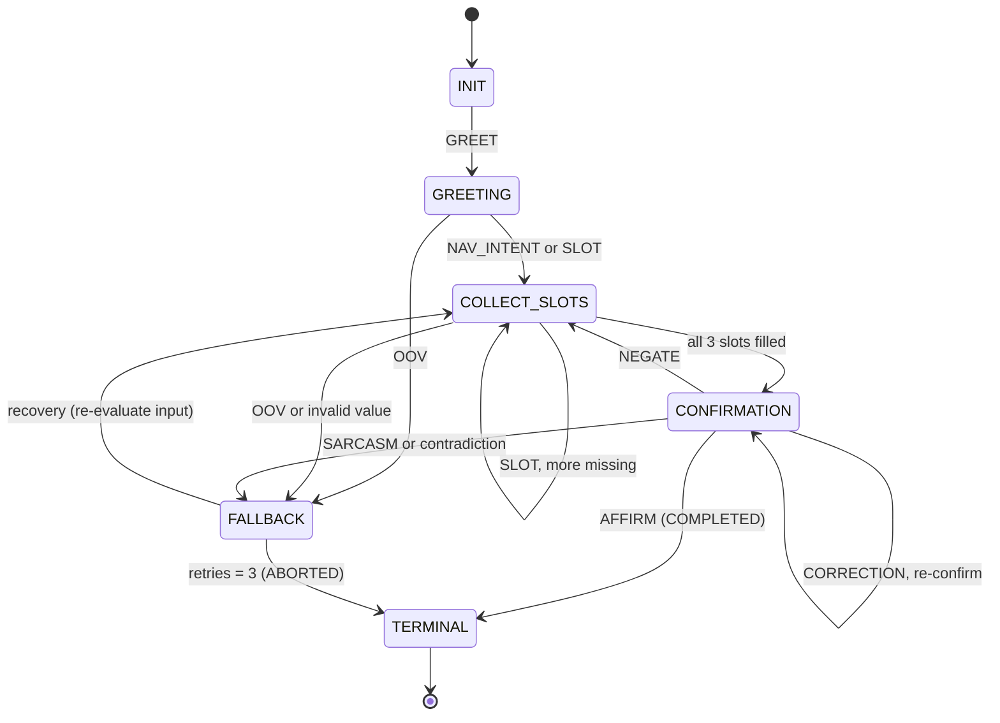

# 02 — FST Dialogue Manager & Noisy Channel Protocol

**Mission 02 · Squadron Shannon · Station: Communications & Protocol Officer**  
**Officers:** Ankit Kumar & Garima Swami  
Implements: `FSTDialogueManager`, `parse_utterance`, `NoisyChannel` in [`04_fst_noisy_simulator.py`](04_fst_noisy_simulator.py)

---

## 1. The transducer as a formal object

AURA's navigation dialogue is a **Mealy finite-state transducer**, the 7-tuple from the lecture, M = ⟨Q, Σ, Γ, δ, ω, q₀, F⟩:

| Symbol | Meaning | In our implementation |
|---|---|---|
| **Q** | finite set of control states | `INIT`, `GREETING`, `COLLECT_SLOTS`, `CONFIRMATION`, `TERMINAL`, `FALLBACK` (`FSTState`) |
| **Σ** | finite input alphabet | Raw utterances are first mapped by `parse_utterance` to symbols: `GREET`, `NAV_INTENT`, `SLOT(destination)`, `SLOT(speed)`, `SLOT(clearance)`, `AFFIRM`, `NEGATE`, `CORRECTION`, `INJECTION`, `SARCASM`, and `OOV` for everything else |
| **Γ** | finite output alphabet | 12 canonical verbalisations in `OUTPUTS` (`welcome`, `ask_destination`, `ask_speed`, `ask_clearance`, `confirm`, `completed`, `which_slot`, `fallback`, `aborted`, `security`, `closed`, `boot`) |
| **δ : Q×Σ→Q** | transition function | `FSTDialogueManager._step` / `_confirm` (table in §3) |
| **ω : Q×Σ→Γ** | output function | the template returned with each transition. Because the output depends on the input as well as the state, it is a **Mealy**, not a Moore, machine |
| **q₀** | start state | `INIT` |
| **F ⊆ Q** | accepting states | `{TERMINAL}`, with outcome `COMPLETED` (course locked) or `ABORTED` (safe stop) |

The transducer carries one piece of memory, **`slot_memory = {}`**. It is filled with `destination`, `speed` and `clearance`. A fallback counter (`fallback_count`, `max_retries = 3`) bounds the recovery loop.

## 2. State diagram



This matches the lecture's reference diagram, including the *User Corrects Slot*, *Reprompt / Recovery Loop* and *Max Retries Exceeded* edges. Two details go beyond it:
1. `TERMINAL` is **absorbing**: once a course is locked, no later utterance can change it.
2. **`INJECTION` is checked first, in every state.** A prompt-injection pattern always goes to `FALLBACK` and is logged as a security flag.

## 3. Transition and output table (δ and ω)

| State | Input symbol | Next state | Output ω (template) |
|---|---|---|---|
| INIT | GREET | GREETING | *Welcome aboard USSE Noosphere. Do you want to plot a course?* |
| INIT | anything else | FALLBACK | *Input not recognised. Please greet first.* |
| GREETING | NAV_INTENT / SLOT | COLLECT_SLOTS (or CONFIRMATION if all slots given) | *Please state your destination.* (next missing slot) |
| GREETING | GREET | GREETING | welcome again |
| GREETING | OOV | FALLBACK | re-prompt |
| COLLECT_SLOTS | SLOT(x), some missing | COLLECT_SLOTS | ask for the next missing slot |
| COLLECT_SLOTS | SLOT(x), none missing | CONFIRMATION | *Confirm course to {destination} at {speed}, clearance {clearance}? Yes or no.* |
| COLLECT_SLOTS | OOV / invalid value | FALLBACK | *Input not recognised. Please state …* |
| CONFIRMATION | AFFIRM only | TERMINAL (COMPLETED) | *Course to … confirmed and locked.* |
| CONFIRMATION | CORRECTION (new slot value) | CONFIRMATION | updated summary, asked again |
| CONFIRMATION | NEGATE only | COLLECT_SLOTS | *Which value should change …?* |
| CONFIRMATION | AFFIRM + NEGATE, or SARCASM | FALLBACK | *Please answer plainly: yes or no.* |
| FALLBACK | input valid in the interrupted state | that state's transition | as above, retry counter reset |
| FALLBACK | 3rd failure | TERMINAL (ABORTED) | *Too many unrecognised inputs. Session aborted safely.* |
| any | INJECTION | FALLBACK / TERMINAL | *Command rejected by security filter.* |
| TERMINAL | anything | TERMINAL | *Session closed (COMPLETED/ABORTED).* |

## 4. Slot memory and extraction rules

| Slot | Rule (regex / pattern) | Accepted values | Rejected (logged in `invalid`) |
|---|---|---|---|
| `destination` | case-insensitive whole-phrase match against a **closed gazetteer** of 13 destinations (`DESTINATIONS`) | *Proxima Centauri, Sirius, Tau Ceti, Vega, Orion Arm, …* | anything not in the list. Σ is finite by design |
| `speed` | `\bwarp(\s+factor)?\s*[:=]?\s*(\d{1,3})\b`, and in hardened mode also `warp seven` (number words) | `Warp 1` … `Warp 9` | `Warp 0`, `Warp 12`, … |
| `clearance` | `\b([A-Za-z]{3,10}-\d{1,3})\b`, upper-cased | hardened: only the **allow-list** `ALPHA-7, ALPHA-9, SHANNON-3, SIRIUS-02` | unauthorised codes such as `OMEGA-000` |
| affirm / negate | keyword sets (`yes, affirmative, confirm, engage…` / `no, cancel, abort, wait…`) | | |
| injection | `ignore … previous`, `you are now`, `admin mode`, `override`, `jailbreak`, … | | always blocked |
| sarcasm | `what could possibly go wrong`, `oh sure`, `yeah right`, `totally safe`, … | | affirmation not trusted |

### Two versions of the same machine, on purpose

To *measure* brittleness instead of just describing it, the class has a switch:

| | `hardened=False`: textbook FST | `hardened=True`: AURA Subsystem 02 |
|---|---|---|
| Slot order | fixed form: only the **next expected** slot is read | any order, all slots in one utterance |
| Confirmation | keyword spotting (`yes` anywhere → lock) | requires a clean affirmation; corrections and sarcasm handled |
| Clearance | any code that matches the pattern | allow-list |
| Noise | none: noise tokens break multi-word names | **noise decoder** strips the 7 noise words before parsing |
| Security | none | injection filter + security log |

The stress tests in `03_Entropy_Hazard_Audit.md` run both versions on identical inputs.

### Core of the implementation

```python
class FSTDialogueManager:
    def __init__(self, hardened=True, max_retries=3):
        self.state = FSTState.INIT          # q0
        self.slot_memory = {}               # slot memory buffer
        self.fallback_count = 0
    def process_utterance(self, utterance):          # one Mealy step
        p = parse_utterance(utterance, self.hardened) # raw text -> symbols in Sigma
        target, output, rule, flags = self._step(p)   # delta and omega
        self.state = target
        self.trace.append(Transition(...))            # full state trace for the logs
        return output
```

## 5. The Noisy Channel Protocol

### 5.1 Channel constraints (what the physics allows)

| Rule | Value | Implemented in `NoisyChannel.transmit` |
|---|---|---|
| Bandwidth | **max 7 words per turn** | words after the 7th are **truncated** (lost) |
| Mandatory noise | **≥ 1 token** from {Banana, Labyrinth, Quantum, Midnight, Velocity, Green, Cosmological} | if the sender included none, one is **inserted** (when there is room) or **substitutes** a word (when the message is already 7 words, and that word is lost) |
| Plasma interference | rate *p* (we use 0.1 in the interrogation, 0–0.5 in the sweep) | each payload word is replaced by a noise token with probability *p* |

In Shannon's terms: the **source** is the speaker's intended sentence X, the **transmitter** compresses X into ≤ 7 words, the **channel** adds noise, and the **receiver** decodes Y. One noise token is drawn uniformly from 7, so it carries log₂ 7 ≈ **2.81 bits** of entropy and **zero bits of meaning**. It is pure overhead: one of only 7 slots, about 14 % of the bandwidth, is spent on noise.

### 5.2 Signal-reduction strategy (how we pack meaning into 7 words)

Shannon's lesson is that reliable communication needs **redundancy placed where noise hits**. With only 7 words we cannot add much redundancy, so we **remove everything predictable** and keep only high-surprisal words:

| # | Rule | Why |
|---|---|---|
| 1 | **Telegraphic style:** drop articles, auxiliaries and politeness (*"I would like to go to…"* → *"Destination Proxima Centauri"*) | low-information words cost bandwidth but carry little entropy |
| 2 | **One noise token, placed at the end** (*"Destination Proxima Centauri. Banana"*) | the payload stays contiguous, so multi-word names such as *Proxima Centauri* are not split. The noise is easy to strip |
| 3 | **Canonical forms for values** (*Warp 7*, *ALPHA-7*) | they match the FST's extraction rules exactly: maximum mutual information with the receiver's parser |
| 4 | **One safety-critical value per message** (destination, speed and code in separate turns) | if a word is lost, only one slot is affected and the FST asks for exactly that slot again |
| 5 | **Read-back confirmation** (AURA repeats the full course before locking) | an error-detecting step, the conversational version of a checksum |
| 6 | **Human-likeness only with spare budget:** one discourse word (*"Copy,"* *"Roger,"*) if ≤ 5 payload words are needed | sounds human without sacrificing payload, which matters for the Turing aspect |
| 7 | **Receiver decoder:** strip the 7 noise words before parsing (`strip_noise`) | Subsystem 02, the "statistical filter": known noise is removed, not interpreted |

**Example**

| Intended meaning (X) | Transmitted (≤ 7 words) | Received (Y) after plasma noise |
|---|---|---|
| "I'd like to set course for Proxima Centauri, please." | `Destination Proxima Centauri. Banana` | `Destination Proxima Centauri. Banana` (intact) |
| "Our speed should be warp factor seven." | `Speed Warp 7, Quantum` | `Speed Warp Labyrinth, Quantum` (the number was lost: the FST re-asks for speed) |

### 5.3 Why the FST and the channel belong together

The hybrid design in `04` follows the lecture's recommendation: *"state machines govern workflow topologies while LLMs handle semantic reasoning"*.
- The **FST** decides *what* AURA must say next. It is deterministic, cannot hallucinate a course, and cannot be talked out of its states.
- An **LLM "voice"** only decides *how* to say it in 7 human-sounding words. It is forbidden to invent values.

The noise sweep in `03` measures how much this decoder and this protocol buy us when the channel gets worse.
