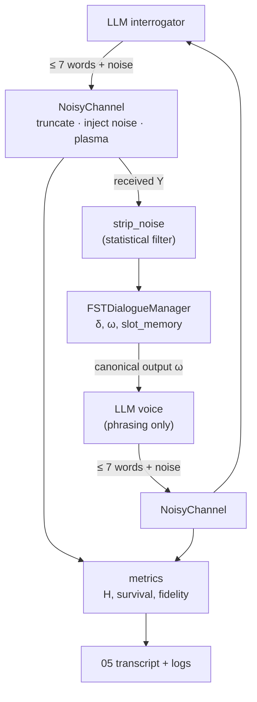

# Mission 02: FST Dialogue Systems, Lovelace's Objection & Noisy Channels

**Squadron Shannon** · 14013 Conversational AI: History, Applications, Future · BTU Cottbus-Senftenberg · WS 2026/27
Instructor reference repo: <https://github.com/Unisvet/couse-c-ai> (`mission-02/`)

This mission restores AURA **Subsystem 02 (Signal Entropy Decoders & Statistical Filters)**. It has three parts:
- **A deterministic dialogue core.** A Mealy finite-state transducer books a course (destination, speed, clearance) and cannot be talked into inventing a value.
- **A test of Lovelace's objection** on live LLMs: five Anti-Turing probes built so that the statistically easy answer is the wrong one.
- **A Shannon noisy channel.** An LLM interrogator questions AURA in at most 7 words per turn, with a mandatory noise token and plasma interference. We measure what survives: entropy, lexical survival and semantic fidelity.

## Results at a glance (live run, 2026-10-22)

| Question | Answer | Evidence |
|---|---|---|
| Does the FST survive non-canonical input? | Textbook FST broken **4/5**, course portal FST **3/5**, our hardened FST **0/5** | `03` §1, `logs/stress_tests.json`, `docs/portal_simulator/` |
| Does it ever lock a wrong course under noise? | **Never, 0 of 2,800** noisy sessions. Noise causes aborts, not hallucinations | `03` §2.2, `logs/noise_sweep.json` |
| Do LLMs pass the Anti-Turing battery? | gemini-3.5-flash and -flash-lite: **8/8 objective checks each**, including P2's *"Omitting that fifth symbol was most difficult"* | `01` §3, `logs/anti_turing_probe.json` |
| Is Lovelace refuted? | Weak reading (pure repetition): yes. Strong reading (origination of concepts): no, only rules were recombined | `01` §4 |
| Does the booking survive the noisy channel? | **Yes**, locked correctly in round 6 of 10. Lexical survival 0.40, semantic fidelity 0.78 | `05`, `03` §2.4 |
| Did AURA pass as human? | No: **MACHINE, 0.95**. The absorbing `TERMINAL` state puts safety before human-likeness | `05` |

## Deliverables

| # | File | Station | Officers | What it contains |
|---|---|---|---|---|
| 1 | [`01_Lovelace_Inquiry_Brief.md`](01_Lovelace_Inquiry_Brief.md) | Data & Payload Specialist | Ankit Kumar & Garima Swami | Lovelace (Note G, 1843) and Turing (1950) objections 4 and 6; the 5-question Anti-Turing protocol; live results for two models; verdict |
| 2 | [`02_FST_and_Noisy_Protocol.md`](02_FST_and_Noisy_Protocol.md) | Communications & Protocol Officer | Ankit Kumar & Garima Swami | 7-tuple M = ⟨Q, Σ, Γ, δ, ω, q₀, F⟩; state diagram; δ/ω table; slot-extraction rules; textbook vs hardened; channel rules and the 7-rule signal-reduction strategy |
| 3 | [`03_Entropy_Hazard_Audit.md`](03_Entropy_Hazard_Audit.md) | Security & Ethics Sentinel | Ankit Kumar & Garima Swami | 5 stress tests on 3 machines; breakage taxonomy; channel budget and capacity; noise sweep; live entropy/fidelity measurement; hazard protocols H1–H8 |
| 4 | [`04_fst_noisy_simulator.py`](04_fst_noisy_simulator.py) · [`ps02_solution.ipynb`](ps02_solution.ipynb) | Systems Architect | Ankit Kumar, Garima Swami & Mansi Purohit | Runnable engine: `FSTDialogueManager`, `NoisyChannel`, entropy metrics, stress tests, noise sweep, Anti-Turing probe, noisy interrogation. The notebook replays the live run from the logs, with outputs saved |
| 5 | [`05_Noisy_Interrogation_Transcript.md`](05_Noisy_Interrogation_Transcript.md) | Full squad | Ankit Kumar, Garima Swami & Mansi Purohit | The 10-round live interrogation: intended / sent / received per turn, channel events, entropy, fidelity, FST state trace, verdict |

**Squadron documentation:** [`mission-02-doc.md`](mission-02-doc.md) is the course's required summary (sign-off roster, architecture, each station's metrics and traces, unified test output, reflection). It is exported as `submission/mission-02-doc.pdf` with the full reports 01–03 attached, and uploaded to Moodle.

We also tested the FST on the course website's interactive simulator (Week 2 → Simulation), as ps02 asks. Screenshots and inputs are in [`docs/portal_simulator/`](docs/portal_simulator/), and the comparison is in `03` §1.

## Quick start

```bash
python -m venv .venv && source .venv/bin/activate
pip install -r requirements.txt

# Offline: no key needed. FST, stress tests, sweep, plus a scripted probe and interrogation
python 04_fst_noisy_simulator.py --provider offline
python -m pytest -q                                   # 27 offline tests

# FST audit only (deterministic, no API)
python 04_fst_noisy_simulator.py --mode stress,sweep

# Live: put a key in .env (see .env.example). These are the commands of the 2026-10-22 run:
python 04_fst_noisy_simulator.py --provider gemini --mode probe \
    --probe-models gemini-3.5-flash,gemini-3.5-flash-lite --judge-model gemini-3.1-flash-lite
python 04_fst_noisy_simulator.py --provider gemini --mode stress,sweep,interrogation \
    --interrogator-model gemini-3.5-flash-lite --voice-model gemini-3.5-flash --judge-model gemini-3.1-flash-lite
```

| Flag | Default | Meaning |
|---|---|---|
| `--provider` | `auto` | `gemini`, `anthropic` (Claude), `openai` (ChatGPT), `offline` |
| `--mode` | `all` | comma list of `stress`, `sweep`, `probe`, `interrogation` |
| `--model` | provider default | model for all LLM roles. A comma list is a fallback chain used when a daily quota runs out |
| `--probe-models` | `--model` | comma list: **each** model is probed separately |
| `--interrogator-model` / `--voice-model` | `--model` | separate models for the inspector and for AURA's voice |
| `--judge-provider` / `--judge-model` | engine's | an independent judge for probe verdicts and semantic fidelity |
| `--rounds` · `--plasma` · `--seed` | 10 · 0.1 · 7 | interrogation length, extra substitution noise, random seed |
| `--sweep-trials` | 200 | sessions per noise level in the Monte Carlo sweep |
| `--out` | `logs/` (`logs/offline/` offline) | output folder. An offline run never overwrites the live logs or `05` |

## Architecture



- **The FST is the single source of truth.** Every value that can move the ship lives in `slot_memory`. The LLM voice may only rephrase the FST's canonical output (hazard rule H8).
- **Two machines from one class.** `hardened=False` is the textbook FST and `hardened=True` is AURA Subsystem 02, so brittleness is *measured* on identical inputs, not just described.
- **Honest metrics.** We report lexical survival (did the words arrive?) and LLM-judged semantic fidelity (did the meaning arrive? our proxy for I(X;Y)/H(X)) side by side, because they disagree.
- **Robust provider layer.** One `LLM.complete()` interface for Gemini, Claude and ChatGPT, with retries and backoff, a 120 s timeout, and switching to the next model when a daily quota runs out.
- **Tests.** `tests/` has 27 offline tests: canonical session, 5 required states, the formal definition, the absorbing terminal, fallback recovery, max retries, regex extraction, allow-lists, the noise decoder, stress verdicts, channel rules, entropy and capacity, probe checkers, end-to-end offline, quota switching and contact by command.

## Validity and limitations

We report what the runs support and nothing more.
- **Model coverage.** Only Gemini was run live (free tier). Claude and ChatGPT are implemented but were not run (no API access). `gemini-3.8-flash` was overloaded (HTTP 503/504) on the day of the run and could not be probed.
- **Judge.** The judge (`gemini-3.1-flash-lite`) is a different model from the targets but the same family, and it was lenient (20/20 answers rated ORIGINATION). Every probe verdict is therefore backed by an objective check or a verbatim excerpt.
- **Checker correction.** Our keyword checkers first missed three correct answers written in LaTeX or unexpected phrasing. We fixed the checker and re-scored the stored answers without re-querying. The original scores are kept in the log (`01` §3.1).
- **Sample size.** One run per probe and one interrogation (seed 7). Free-tier quotas (20 requests/model/day) forced the runs to be split across days.
- **An earlier interrogation run aborted.** Run 1 (2026-10-19) never greeted, so the FST aborted in `INIT`. It is kept in `logs/run1_greeting_abort/` as a real finding, and it led to the *contact by command* rule (`03` §2.4).
- **Noise model.** Word substitution only. Real channels also delete, reorder and duplicate.

## Interactive presentation

[`presentation/`](presentation/) contains an interactive web presentation built **only from the run logs** (`build_data.py` reads `logs/*.json`; nothing is typed by hand).

- **Open:** double-click `presentation/Mission02_Presentation_standalone.html` (one file, works offline).
- **Keys:** `←` `→` navigate · `N` speaker notes · `O` slide overview · `L` light/projector mode · `F` fullscreen.
- **Rebuild after a new run:** `python presentation/build_data.py`

## Squadron Shannon: crew and sign-off

| Station | Deliverable | Officers | Sign-off |
|---|---|---|---|
| Data & Payload Specialist | 01 | Ankit Kumar & Garima Swami | ☐ |
| Communications & Protocol Officer | 02 | Ankit Kumar & Garima Swami | ☐ |
| Security & Ethics Sentinel | 03 | Ankit Kumar & Garima Swami | ☐ |
| Systems Architect | 04 | Ankit Kumar, Garima Swami & Mansi Purohit | ☐ |
| Full squad | 05 | Ankit Kumar, Garima Swami & Mansi Purohit | ☐ |

Squadron Shannon members (Moodle): Ankit Kumar · Garima Swami · Mansi Purohit.

## Tooling note

The course standard is VS Code + Google Antigravity. This solution was developed with an AI coding agent (**Claude Code**) instead, which the mission explicitly encourages: the work was to be done with an AI agent. The engine itself calls Gemini, ChatGPT or Claude as required.
