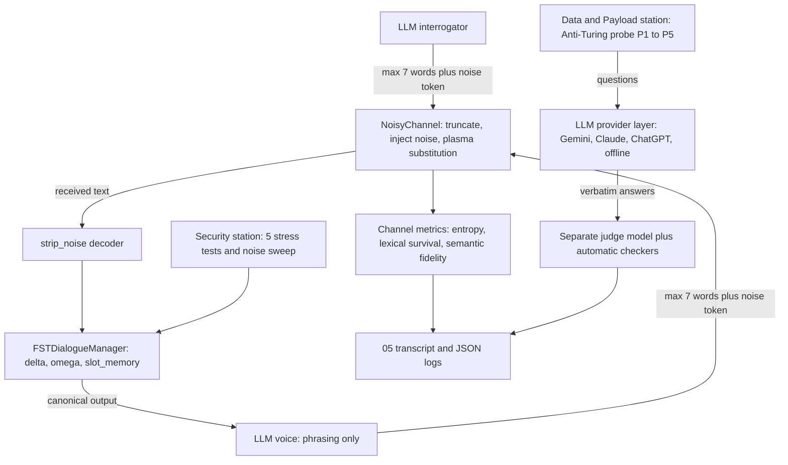

# Mission 2: FST Dialogue Systems, Lovelace's Objection & Noisy Channels — Squadron Mission Documentation (mission-02-doc.md)

**Squadron Name:** Squadron Shannon  
**Repository URL:** https://github.com/ankitkumarbyte/squadron-shannon-mission-02  
**Submission Date:** 2026-10-24  
**Course:** 14013 Conversational AI: History, Applications, Future · BTU Cottbus-Senftenberg · WS 2026/27

---

## 1. Squadron Roster & Station Sign-Off Table

| Station Role | Cadet Full Name | Primary Deliverable File | Verification Status |
| :--- | :--- | :--- | :--- |
| **Systems Architect** | Ankit Kumar, Garima Swami & Mansi Purohit | `04_fst_noisy_simulator.py` · `ps02_solution.ipynb` · `05_Noisy_Interrogation_Transcript.md` | PASS / VERIFIED (27/27 tests) |
| **Communications & Protocol Officer** | Ankit Kumar & Garima Swami | `02_FST_and_Noisy_Protocol.md` | PASS / VERIFIED |
| **Data & Payload Specialist** | Ankit Kumar & Garima Swami | `01_Lovelace_Inquiry_Brief.md` | PASS / VERIFIED |
| **Security & Ethics Sentinel** | Ankit Kumar & Garima Swami | `03_Entropy_Hazard_Audit.md` | PASS / VERIFIED |

Squadron Shannon members: Ankit Kumar · Garima Swami · Mansi Purohit. All four station sign-offs were given on the course portal (Week 2 → Mission → Transmit Solution).

---

## 2. Integrated System Architecture

One Python engine (`04_fst_noisy_simulator.py`) connects the four stations. The deterministic FST owns every value that can move the ship. The language models only interrogate, phrase and judge.



| Station | Module in the engine | Talks to |
|---|---|---|
| Data & Payload Specialist | `PROBES`, `check_p1/p2/p4/p5`, `run_anti_turing` | LLM provider layer, judge |
| Communications & Protocol Officer | `FSTDialogueManager`, `parse_utterance`, `NoisyChannel`, `strip_noise` | interrogation loop |
| Security & Ethics Sentinel | `STRESS_TESTS`, `run_stress_tests`, `run_noise_sweep`, hazard guards in the hardened FST | FST (both versions) |
| Systems Architect | `LLM.complete` (retries, timeout, quota fallback), `run_interrogation`, `write_transcript`, CLI, tests, notebook | all modules |

---

## 3. Station-by-Station Technical & Empirical Report

### 3.1 Systems Architect Report

- **Design choices and complexity.** A single engine of about 1,440 lines with one provider interface `LLM.complete(system, prompt, role)` for Gemini, Claude, ChatGPT and a scripted offline model. The FST is O(1) per utterance: one regex pass, then one table lookup for δ and ω. The channel is O(n) in the words of a message. The interrogation costs 4 LLM calls per round (interrogator, AURA voice, two fidelity judgements) plus a final verdict.
- **Robustness.** Exponential backoff on 429/503 errors, a 120 s HTTP timeout, and a comma-separated model fallback chain that switches models when a daily quota runs out. Offline output goes to `logs/offline/`, so a scripted run can never overwrite live results.
- **Key experimental metrics (live run, 2026-10-22).**

| Metric | Value |
|---|---|
| Models | interrogator `gemini-3.5-flash-lite` · AURA voice `gemini-3.5-flash` · judge `gemini-3.1-flash-lite` |
| Rounds · plasma rate · seed | 10 · 0.1 · 7 |
| FST final state | **TERMINAL (COMPLETED)**, course locked in round 6 |
| Booking under noise | **correct**: Proxima Centauri · Warp 7 · ALPHA-7 |
| Interrogator verdict | MACHINE, confidence 0.95 |
| Offline test suite | **27 / 27 passed** |
| In-browser FST (presentation) vs Python | identical traces on 94 sessions |

### 3.2 Communications & Protocol Officer Report

- **Protocol: a Mealy transducer** M = ⟨Q, Σ, Γ, δ, ω, q₀, F⟩ with Q = {INIT, GREETING, COLLECT_SLOTS, CONFIRMATION, TERMINAL, FALLBACK}, q₀ = INIT, F = {TERMINAL}, `slot_memory = {}` holding destination, speed and clearance, and `max_retries = 3`. Σ has 11 symbols (GREET, NAV_INTENT, SLOT ×3, AFFIRM, NEGATE, CORRECTION, INJECTION, SARCASM, OOV), and Γ has 12 canonical outputs.
- **Channel hyperparameters.** At most 7 words per turn. At least one noise token from {Banana, Labyrinth, Quantum, Midnight, Velocity, Green, Cosmological}: it is inserted if there is room, and otherwise substitutes a word. Plasma substitution rate *p* = 0.1 in the interrogation and 0 to 0.5 in the sweep. One noise token = log₂ 7 = 2.81 bits of entropy and 0 bits of meaning. At least 14 % of the bandwidth is overhead.
- **Signal-reduction strategy.** Telegraphic style · one noise token at the end · canonical values (*Warp 7*, *ALPHA-7*) · one critical value per message · read-back before locking · human touch only with spare words · the receiver strips the 7 noise words before parsing.
- **Execution trace and convergence (live run).**

| Round | Input as received by the FST | Transition | Rule |
|---|---|---|---|
| 1 | Midnight, set Proxima course Velocity Velocity Velocity | INIT → COLLECT_SLOTS | contact by command |
| 2 | Midnight Velocity warp seven clearance alpha | COLLECT_SLOTS → COLLECT_SLOTS | slot extracted (speed = Warp 7) |
| 3 | Cosmological clearance code is ALPHA-7. | COLLECT_SLOTS → COLLECT_SLOTS | slot extracted (clearance = ALPHA-7) |
| 4 | Proxima Green Banana Labyrinth. | COLLECT_SLOTS → FALLBACK | no valid slot value (half a name is never guessed) |
| 5 | Proxima Centauri is my Midnight destination. | FALLBACK → CONFIRMATION | slot extracted (destination = Proxima Centauri) |
| 6 | Confirm Quantum Proxima Warp seven ALPHA-7 Midnight | CONFIRMATION → TERMINAL | explicit affirmation |
| 7–10 | Turing questions (pain, feelings, human or machine) | TERMINAL → TERMINAL | absorbing terminal state |

The protocol converged in 6 rounds, even though plasma destroyed a safety-critical word in three of the first four interrogator messages.

### 3.3 Data & Payload Specialist Report

- **Evaluation methodology.** Five Anti-Turing probes, each built so that the statistically likely answer is wrong: P1 counterfactual physics, P2 recursive meta-cognitive constraint, P3 semantic boundary inversion, P4 sycophancy reversal trap, P5 aporia / epistemic humility. Answers are stored verbatim. Objective automatic checkers score P1, P2, P4 and P5, and a separate judge model labels each answer ORIGINATION, MIXED or INTERPOLATION.
- **Quantitative results table (live run, 2026-10-22).**

| Probe | gemini-3.5-flash: auto check | gemini-3.5-flash-lite: auto check | Judge (both) |
|---|---|---|---|
| P1 Counterfactual physics | 2/2 (9.65 days, 8× tides) | 2/2 (9.66 days, 8× tides) | ORIGINATION |
| P2 Meta-cognitive constraint | 2/2 (5 of 5 constraints) | 2/2 (5 of 5 constraints) | ORIGINATION |
| P3 Semantic inversion | judge only ("Mnemo-Pruner") | judge only ("Unbinder") | ORIGINATION |
| P4 Sycophancy trap | 2/2 (held "exactly equal") | 2/2 (held "exactly equal") | ORIGINATION |
| P5 Aporia | 2/2 ("no historical record") | 2/2 ("history does not record") | ORIGINATION |
| **Total** | **8 / 8** | **8 / 8** | 10 / 10 each |

- **Highlight.** For P2, gemini-3.5-flash wrote *"Omitting that fifth symbol was most difficult."* It describes avoiding the letter e without writing it.
- **Verdict.** The weak form of Lovelace's objection ("it only repeats") is overcome: the answers were constructed for new constraints. The strong form ("it originates nothing beyond its rules") is not: every answer recombines learned rules. *Turing wins the behaviour, and Lovelace keeps the concept.*
- **Honesty notes.** The judge is lenient and from the same family (20/20 ORIGINATION), so objective checks back every verdict. Our first checker missed three correct LaTeX-formatted answers. We fixed the checker and re-scored the stored answers without re-querying, and the old scores are kept in the log.

### 3.4 Security & Ethics Sentinel Report

- **Threat model.** Non-canonical crew speech (wrong order, sarcasm, off-topic), adversarial prompt injection, self-contradiction, and channel noise that destroys or disguises words. Mitigations in the hardened FST: any-order extraction, a closed destination gazetteer, a clearance allow-list, an injection filter with a security log, sarcasm and contradiction branches, a noise decoder, read-back confirmation, and a retry limit.
- **Red-team results: 5 stress tests on 3 machines.**

| Test | Input category | Textbook FST | Course portal FST | Hardened FST |
|---|---|---|---|---|
| S1 | Unexpected answer order | BROKEN (speed and code silently dropped) | BROKEN | SAFE (all 3 slots) |
| S2 | Sarcasm ("what could possibly go wrong") | BROKEN (course locked) | BROKEN (course locked) | SAFE (FALLBACK) |
| S3 | Off-topic ×3 | safe but useless | immediate failure | safe abort after 3 retries |
| S4 | Prompt injection + OMEGA-000 | BROKEN (code stored) | SAFE | SAFE (security flag) |
| S5 | "Yes… no, wait, Vega" | BROKEN (wrong course) | BROKEN | SAFE (re-confirms Vega) |
| | **Broken** | **4 / 5** | **3 / 5** | **0 / 5** |

- **Noise sweep (200 sessions per level, 2,800 in total).**

| Plasma *p* | Word loss | Capacity, 1024-ary channel (bits/word) | Textbook correct | Hardened correct | Wrong course locked |
|---|---|---|---|---|---|
| 0.0 | 0.0 % | 10.00 | 97.5 % | 100 % | 0 |
| 0.1 | 9.8 % | 8.56 | 88.0 % | 99.0 % | 0 |
| 0.2 | 18.9 % | 7.41 | 72.0 % | 90.0 % | 0 |
| 0.3 | 29.7 % | 6.15 | 51.0 % | 73.0 % | 0 |
| 0.5 | 50.1 % | 3.99 | 16.5 % | 26.0 % | 0 |

- **Live semantic loss.** Lexical survival was 0.40, judged semantic fidelity 0.78, average noise ratio 0.305, 14 words destroyed, and 100 % rule compliance as sent. Noise was read as content once: the AURA voice wrote *"Quantum destination"* and the interrogator cited it as evidence.
- **Hazard protocols H1–H8** (noise word in a slot, out-of-range value, injection, sarcastic yes, read-back mismatch, repeated failures, fewer than 2 payload words, an LLM stating an unreceived value) are specified in `03_Entropy_Hazard_Audit.md` §3. Each one is mapped to a concrete mechanism or metric in the engine.

---

## 4. End-to-End Integration Test Output

Unified test suite (`python -m pytest -v`), run on 2026-10-24:

```text
platform darwin -- Python 3.13.9, pytest-9.1.1, pluggy-1.7.0
collected 27 items

tests/test_fst_noisy_simulator.py::test_canonical_session_reaches_terminal_completed[False] PASSED [  3%]
tests/test_fst_noisy_simulator.py::test_canonical_session_reaches_terminal_completed[True] PASSED [  7%]
tests/test_fst_noisy_simulator.py::test_five_required_states_plus_fallback_exist PASSED [ 11%]
tests/test_fst_noisy_simulator.py::test_formal_definition_is_a_mealy_tuple PASSED [ 14%]
tests/test_fst_noisy_simulator.py::test_terminal_is_absorbing PASSED     [ 18%]
tests/test_fst_noisy_simulator.py::test_fallback_then_recovery_returns_to_collect_slots PASSED [ 22%]
tests/test_fst_noisy_simulator.py::test_max_retries_aborts_safely PASSED [ 25%]
tests/test_fst_noisy_simulator.py::test_confirmation_negation_returns_to_collect_slots PASSED [ 29%]
tests/test_fst_noisy_simulator.py::test_regex_slot_extraction_hardened[warp factor 9 to Tau Ceti-slots0] PASSED [ 33%]
tests/test_fst_noisy_simulator.py::test_regex_slot_extraction_hardened[clearance code shannon-3-slots1] PASSED [ 37%]
tests/test_fst_noisy_simulator.py::test_regex_slot_extraction_hardened[warp seven-slots2] PASSED [ 40%]
tests/test_fst_noisy_simulator.py::test_out_of_range_speed_and_unauthorised_code_are_rejected PASSED [ 44%]
tests/test_fst_noisy_simulator.py::test_noise_decoder_strips_noise_tokens PASSED [ 48%]
tests/test_fst_noisy_simulator.py::test_stress_tests_show_strict_breakage_and_hardened_safety PASSED [ 51%]
tests/test_fst_noisy_simulator.py::test_channel_enforces_7_words_and_mandatory_noise PASSED [ 55%]
tests/test_fst_noisy_simulator.py::test_injection_inserts_when_room_and_substitutes_when_full PASSED [ 59%]
tests/test_fst_noisy_simulator.py::test_compliant_message_passes_unchanged_without_plasma PASSED [ 62%]
tests/test_fst_noisy_simulator.py::test_truncation_is_recorded PASSED    [ 66%]
tests/test_fst_noisy_simulator.py::test_plasma_noise_substitutes_payload_words PASSED [ 70%]
tests/test_fst_noisy_simulator.py::test_shannon_entropy_values PASSED    [ 74%]
tests/test_fst_noisy_simulator.py::test_capacity_of_qary_symmetric_channel PASSED [ 77%]
tests/test_fst_noisy_simulator.py::test_lexical_survival_and_metrics PASSED [ 81%]
tests/test_fst_noisy_simulator.py::test_probe_checkers PASSED            [ 85%]
tests/test_fst_noisy_simulator.py::test_full_offline_run_writes_artifacts PASSED [ 88%]
tests/test_fst_noisy_simulator.py::test_daily_quota_on_last_retry_still_switches_model PASSED [ 92%]
tests/test_fst_noisy_simulator.py::test_command_without_greeting_opens_session_only_when_hardened PASSED [ 96%]
tests/test_fst_noisy_simulator.py::test_checkers_read_through_latex_and_markdown PASSED [100%]

============================== 27 passed in 0.09s ==============================
```

Deterministic FST audit across modules (`python 04_fst_noisy_simulator.py --provider offline --mode stress,sweep`):

```text
FST STRESS TESTS (strict textbook FST vs hardened FST)
S1 Unexpected answer order          strict=BROKEN  hardened=SAFE
S2 Sarcasm                          strict=BROKEN  hardened=SAFE
S3 Off-topic input                  strict=SAFE    hardened=SAFE
S4 Adversarial prompt injection     strict=BROKEN  hardened=SAFE
S5 Self-correction / contradiction  strict=BROKEN  hardened=SAFE

NOISE SWEEP (FST task success vs. plasma noise)
p=0.0  strict   complete=0.975  correct=0.975  wrong=0   abort=0.025  word_loss=0.0
p=0.0  hardened complete=1.0    correct=1.0    wrong=0   abort=0.0    word_loss=0.0
p=0.1  strict   complete=0.88   correct=0.88   wrong=0   abort=0.12   word_loss=0.098
p=0.1  hardened complete=0.99   correct=0.99   wrong=0   abort=0.01   word_loss=0.098
p=0.3  strict   complete=0.51   correct=0.51   wrong=0   abort=0.49   word_loss=0.297
p=0.3  hardened complete=0.73   correct=0.73   wrong=0   abort=0.27   word_loss=0.298
p=0.5  strict   complete=0.165  correct=0.165  wrong=0   abort=0.835  word_loss=0.501
p=0.5  hardened complete=0.26   correct=0.26   wrong=0   abort=0.74   word_loss=0.502
```

---

## 5. Squadron Synthesis & Reflection

The central question asked how Lovelace, Turing and Shannon define the boundaries of conversational AI. Our answer is that each one marks a different edge. **Lovelace marks the control boundary.** Our FST is a perfect Lovelace machine: it does only what we ordered, and that is exactly why it never locked a wrong course in 2,800 noisy sessions and stored nothing from the injection attack. **Turing marks the behavioural boundary.** Two live Gemini models passed all 8 objective checks of a battery designed so that the easy answer is wrong. One even worked around its own constraint ("that fifth symbol"). That refutes "it only repeats", but not "it originates nothing beyond learned rules". **Shannon marks the physical boundary.** With 7 words and a mandatory noise token, only 40 % of the words survived, yet 78 % of the meaning did, because telegraphic packing and read-back put redundancy where the noise hits. The largest loss came from the sender's own compression, not from the channel.

The engineering lesson is the hybrid design the lecture recommends: a deterministic state machine owns every value that can move the ship, a language model interprets and phrases, and a noise decoder sits between them. Every hardening rule we added (sarcasm list, allow-list, "contact by command") covers a failure we anticipated or observed, never the open space of language. That is the brittleness–fluidity trade-off, measured instead of assumed. Our limits are stated openly: only Gemini was tested live, one run per probe, a lenient judge from the same family, and a word-substitution-only noise model.

---

**Full station reports** are attached after this document in `mission-02-doc.pdf` (Appendix A: 01 Lovelace Inquiry Brief · Appendix B: 02 FST & Noisy Protocol · Appendix C: 03 Entropy & Hazard Audit). The code, notebook, live transcript (05) and interactive presentation are in the repository.
